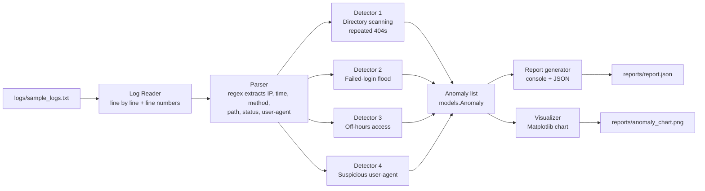

# Architecture & Workflow


## Pipeline



## Stages
| Stage | Module | Input | Output |
|---|---|---|---|
| 1. Read | `scanner.py` | log file path | (line_no, raw line) stream |
| 2. Parse | `scanner.py` | raw line | record: ip, timestamp, method, path, status, size, user-agent |
| 3. Detect | `scanner.py` | records | `Anomaly` objects (regex/DFA per type, with sliding window per IP) |
| 4. Report | `report.py` | `Anomaly` list | coloured console report + JSON |
| 5. Visualise | `visualize.py` | report dict | PNG chart |

## Design decisions
- **Single shared contract** (`models.Anomaly`): detectors and reporting are developed independently.
- **One pass over the file**; each line is parsed once, then offered to all four detectors.
- **Stateful detectors** (directory scanning, login flood) keep a per-IP window of recent events; stateless ones
  (off-hours, user-agent) decide from a single line.
- **Malformed lines** are skipped and counted, never crash the scan.
- **Line numbers are 1-based** and refer to the original file, so results can be compared directly with
  `tests/expected_anomalies.md`.

## Interface the scanner must provide
```python
# src/scanner.py
def scan_file(path: str) -> list[models.Anomaly]: ...
```
