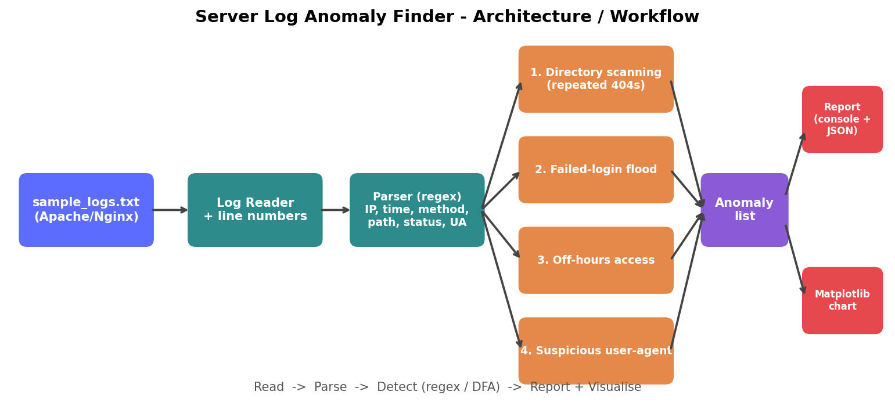
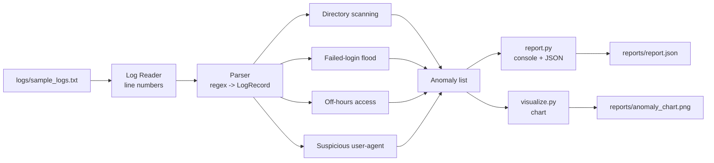

# Project Architecture

Single source of truth for how the project is organised, who owns what, and how the
pieces connect. If you are unsure where something goes, look here first.

## 1. Overview
```
logs/sample_logs.txt -> Parser -> 4 Detectors -> Anomaly list -> Report (console + JSON) + Chart
```




## 2. Folder structure, owners and status
```
server-log-anomaly-finder/
├── README.md                 project overview, setup, run, test            M4
├── requirements.txt          matplotlib                                    M4
├── .gitignore                                                              M4
├── logs/
│   └── sample_logs.txt       ~200 lines, normal + injected anomalies       M3
├── docs/
│   ├── log_format.md         log fields, 10+ examples, SIEM/Splunk notes   M1
│   ├── regex_patterns.md     4 regexes, explanations, sample matches       M2
│   ├── dfa_design.md         DFA diagrams + transition tables              M2
│   ├── architecture.md       this file                                     M4
│   ├── architecture.png      workflow diagram                              M4
│   ├── report_format.md      report/JSON/chart specification               M4
│   ├── week2_checklist.md    hand-off checklist                            M4
│   └── slides.pptx           mini SIEM vs Splunk presentation              M4
├── src/
│   ├── models.py             shared data contracts (LogRecord, Anomaly)    DONE (M4)
│   ├── scanner.py            parser + 4 detectors + scan_file()            SKELETON -> M2
│   ├── report.py             console + JSON report                         DONE (M4)
│   ├── visualize.py          Matplotlib chart                              DONE (M4)
│   └── main.py               CLI entry point                               DONE (M4)
├── tests/
│   ├── expected_anomalies.md ground truth: line numbers + types            M3
│   ├── test_report.py        unit tests for report/chart                   DONE (M4)
│   ├── test_scanner.py       parser/detector tests vs expected_anomalies   TODO (M2/M3)
│   └── demo_report.py        demo report without scanner                   DONE (M4)
└── reports/                  generated output (report.json, chart.png)     auto
```
Roles are from the Week 1 brief (M1-M4). Week 2 roles in the problem statement differ slightly
(scanner = M2, log generator = M3, report/chart/slides = M4); agree final ownership in the team chat.

## 3. Modules and interfaces
| Module | Responsibility | Public functions |
|---|---|---|
| `models.py` | Data contracts only, no logic | `LogRecord`, `Anomaly`, `ANOMALY_TYPES`, `SEVERITIES` |
| `scanner.py` | Read file, parse, detect | `parse_line(n, line) -> LogRecord \| None`, `detect_*(records) -> list[Anomaly]`, `scan_file(path) -> list[Anomaly]` |
| `report.py` | Build and print report | `build_report(anomalies, file, total_lines)`, `write_json(report, path)`, `print_console(report)` |
| `visualize.py` | Chart | `make_chart(report, out_path)` |
| `main.py` | CLI glue | `main(argv)` |

Dependency direction (no cycles): `main -> scanner, report, visualize -> models`.

## 4. Data contracts
**LogRecord** (parser output): `line_no, ip, date, time, method, path, status, size, user_agent, raw`.

**Anomaly** (detector output): `type, severity, ip, start_time, end_time, line_numbers, description, evidence`.
`type` must be one of the four constants in `models.py`; `severity` one of `LOW/MEDIUM/HIGH`;
`line_numbers` are 1-based and match `tests/expected_anomalies.md`.

**Log line formats the parser must accept**
```
192.168.1.5 - - [20/Jun/2026:03:21:00] 'GET /admin HTTP/1.1' 404 512                      (problem-statement sample)
192.168.1.5 - - [20/Jun/2026:03:21:00 +0000] "GET /admin HTTP/1.1" 404 512 "-" "UA string"  (standard Apache combined)
```
User-agent is only available in the combined format, so `sample_logs.txt` must use it (needed for the
user-agent detector).

## 5. Detector design
| Detector | Type | State | Input fields | Needs from M2 |
|---|---|---|---|---|
| Directory scanning | stateful | per-IP recent 404 times | ip, time, status, path | N (404s) and window |
| Failed-login flood | stateful | per-IP recent failures | ip, time, status, path, method | login paths, N, window |
| Off-hours access | stateless | none | time (and path for severity) | business hours |
| Suspicious user-agent | stateless | none | user_agent | tool list / abnormal-UA regex |

All thresholds live as constants at the top of `scanner.py` (one place to change).

## 6. Error handling
- Malformed or blank lines: skipped, never crash.
- Missing file: `main.py` exits with a clear message (exit code 1).
- Scanner missing/unfinished: clear message (exit codes 2/3).
- No anomalies: report and chart still generated (zero counts).

## 7. Testing strategy
1. `tests/test_report.py` - reporting layer (exists, passing).
2. `tests/test_scanner.py` - run `scan_file` on `logs/sample_logs.txt` and compare with `tests/expected_anomalies.md`
   (every expected line flagged; normal lines not flagged).
3. Manual demo: `python src/main.py logs/sample_logs.txt`.

## 8. Build order (who waits for whom)
1. M1 `log_format.md` and M2 regexes/thresholds -> unblock the parser/detectors.
2. M3 `sample_logs.txt` + `expected_anomalies.md` -> unblock testing.
3. Scanner implemented against `models.py` (available now).
4. M4 runs the full pipeline, updates sample output/chart/slides with real results.

## 9. Git workflow
- Branch per task (`docs/regex-patterns`, `feat/scanner`, `data/sample-logs`); merge via pull request.
- Commit from your own account; small, descriptive messages (`feat: add failed-login detector`).
- Never commit `__pycache__` or generated reports (covered by `.gitignore` / `reports/`).
